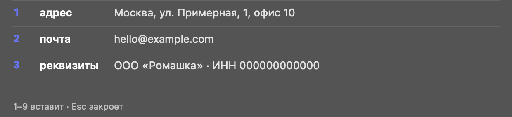
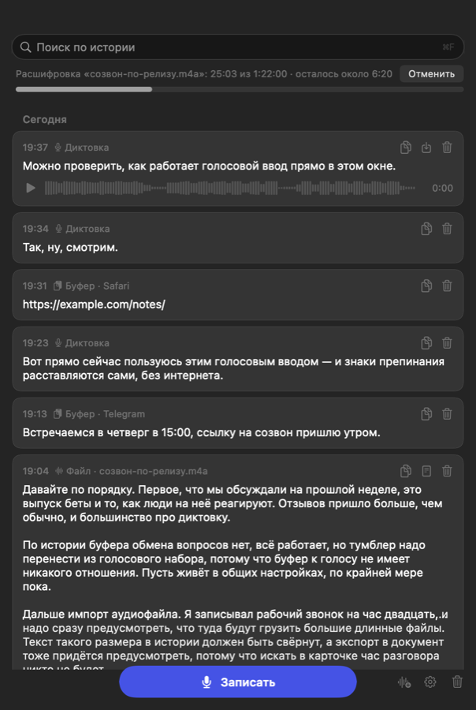
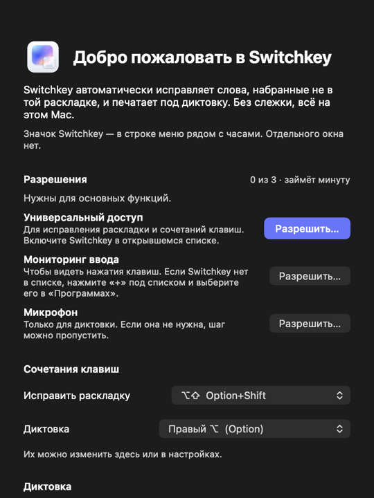

  

<h1 align="center">Switchkey</h1>

  <b>Пишите и не думайте о раскладке.</b> 
  Исправляет «ghbdtn» на «привет», печатает под диктовку и переводит выделенное — 
  прямо на вашем Mac, без облака и без слежки.

  
  
  
  
  

  <a href="https://github.com/DoJustCode/switchkey/releases/latest"><b>⬇︎ Скачать для Mac</b></a>
  &nbsp;·&nbsp;
  <a href="docs/quickstart.md">Первые пять минут</a>
  &nbsp;·&nbsp;
  <a href="docs/guide.md">Руководство</a>

  

---

## Знакомо?

Вы пишете сообщение, поднимаете глаза — а там `Lj,hjt enhj! Rfr ltkf&`. Стираете, переключаете
язык, набираете заново. И так по десять раз на дню.

**Switchkey просто исправляет это сам.** Допишите слово и нажмите пробел — оно уже на нужном
языке, а раскладка переключилась. Ничего настраивать не нужно.

## Что он умеет

### ⌨️ Исправляет раскладку — сам или по ⌥⇧

- Слово исправляется, как только вы его допишете, а иногда прямо посреди набора.
- Ошибся? Нажмите **⌥⇧** — слово вернётся как было. Вернёте одно слово несколько раз —
  Switchkey предложит больше его не трогать.
- Не исправил сам? Тот же **⌥⇧** переключит последнее слово. Включите «Повторное нажатие
  расширяет охват» — и каждое следующее нажатие захватит ещё слово, вплоть до целой фразы.
- В Telegram, Slack и почте исправленное слово уходит **уже правильным**: Switchkey успевает
  поправить его до того, как Enter отправит сообщение.
- Понимает, где трогать нельзя: в терминале и видеоредакторе ничего не делает сам, в редакторах
  кода исправляет только очевидное, а в поле пароля даже не видит нажатий.

### 🎙 Печатает под диктовку — локально

  

Нажмите **правый ⌥**, скажите — и текст появится там, где стоит курсор: в любой программе, даже
там, где нет системной диктовки. Распознаёт модель **Parakeet** на нейронном движке Apple:
быстро, с пунктуацией и **без отправки голоса куда-либо**. Пока вы говорите, сказанное видно на
плашке:

Можно убрать точку в конце (для мессенджеров), сразу отправлять Enter, приглушать музыку на время
записи и научить его своим словам — «экомвижен» станет «EcomVision». IT-термины он сам пишет
латиницей: «выкатил на стейджинг» → «выкатил на staging», «гитхаб» → GitHub.

Курсор оказался не в поле? Текст не уйдёт в никуда: он останется в истории, а плашка предложит
его скопировать. Если наушники слышно плохо, «Проверить микрофон» покажет, что именно слышит
Switchkey и что распозналось.

### 🌍 Переводит выделенное

  

Выделите текст и нажмите **⌃⌥T** — перевод встанет на место выделения. Русский ↔ английский,
направление определяется само. Работает встроенный переводчик macOS: офлайн, бесплатно, без
копирования в браузер.

### ⚡️ Сниппеты и автозамена

Добавьте сокращение `сув` — и по пробелу оно развернётся в «С уважением, Алексей». Длинные тексты (реквизиты, адрес,
шаблон письма) вызываются списком по сочетанию клавиш и вставляются цифрой:

### 🗂 История — чтобы ничего не потерять

Последние диктовки (и, если хотите, скопированный текст) лежат в истории: найти, скопировать,
переслушать. Всё зашифровано и хранится только на вашем Mac, а через час по умолчанию удаляется
само. Можно поставить пароль на окно истории.

### 🔒 Приватный режим

Вводите пароль, номер карты или сид-фразу? **⌃⌥P** — и Switchkey ничего не исправляет и ничего не
запоминает, а в строке меню вместо значка горит замок. Добавьте менеджер паролей или
криптокошелёк в список — и режим будет включаться в нём сам.

### И ещё много приятных мелочей

- **Мгновенная смена языка** клавишей 🌐, Caps Lock или любым сочетанием — без той секундной
  задержки, что у системы.
- **Caps Lock как индикатор языка:** горит — русский, не горит — английский.
- **Удалили строку по ошибке** — внизу появится «Вернуть»:
   
- **Опечатки и «КОгда»** — исправит механические ошибки и случайный Caps Lock (включается в
  настройках).
- **Вставка без форматирования** — текст принимает оформление места, куда вставлен.
- **Запись разговора** ⌥-кликом по значку: звонок расшифровывается в текст прямо на Mac.
- **Перенос настроек** на другой Mac одним файлом.
- **Все сочетания на одной странице** — с подсветкой, если два действия случайно повесили на одно
  сочетание. И поиск по настройкам.

## Switchkey и обычный Mac

| | Обычный Mac | Switchkey |
|---|:---:|:---:|
| Исправить слово, набранное не в той раскладке | стереть и набрать заново | **само** или **⌥⇧** |
| Исправление до отправки в мессенджере | — | ✓ |
| Смена языка без задержки | задержка у 🌐 и Caps Lock | ✓ |
| Диктовка в любую программу | не везде | ✓ |
| Диктовка без интернета, с пунктуацией | зависит от языка | ✓ |
| Перевод выделенного на месте | в отдельном окне | **⌃⌥T** |
| Сниппеты по сочетанию | — | ✓ |
| История диктовки и буфера | — | ✓, зашифрована |
| Режим «ничего не запоминай» для паролей | — | ✓ |

## Приватность — не пункт маркетинга

Switchkey видит вашу клавиатуру, поэтому обещания здесь простые и проверяемые:

- **Ничего не уходит в интернет.** Ни набранный текст, ни голос, ни буфер обмена. В сеть
  программа выходит только по вашей кнопке — скачать модель распознавания речи, и скачанное
  сверяется по хешам.
- **Нет аккаунтов, аналитики и телеметрии.** Обновления Switchkey только проверяет, и то по вашей
  кнопке или раз в сутки, если вы сами это включили. Скачиваете и ставите новую версию вы.
- **История зашифрована** ключом из связки ключей и не покидает Mac.
- **В журнал не пишется содержимое** — только длины слов и события, чтобы разбираться с
  проблемами.
- **В поле пароля Switchkey слеп**, а пароль из менеджера паролей в буфере обмена он даже не
  читает.

Проверить можно самому: `lsof -nP -i -a -c Switchkey` во время работы выводит пустой список.
Подробно — в разделе [«Приватность и безопасность»](docs/privacy.md).

## Начать за минуту

1. **Скачайте** `Switchkey-1.1.0.dmg` со [страницы выпусков](https://github.com/DoJustCode/switchkey/releases/latest).
2. **Перетащите** Switchkey в «Программы» и запустите. Программа подписана и проверена Apple —
   никаких «не удалось проверить разработчика».
3. **Нажмите три кнопки** в окне знакомства: Универсальный доступ, Мониторинг ввода и (если нужна
   диктовка) Микрофон.

Готово. Наберите в любом поле `ghbdtn` и пробел.

Нужен Mac на Apple Silicon (M1 и новее) с macOS 14 или новее. Перевод — macOS 15+.

## Шпаргалка

| Что | Сочетание |
|---|---|
| Исправить последнее слово / отменить исправление | **⌥⇧** (можно левый, правый или любой ⌥) |
| Диктовка | **правый ⌥** |
| Перевести выделенное | **⌃⌥T** |
| Приватный режим | **⌃⌥P** |
| Остановить запись диктовки без вставки | **Esc** |
| Записать разговор | **⌥-клик** по значку в строке меню |

Все сочетания меняются в настройках.

## Вопросы

<b>Почему Switchkey просит доступ к клавиатуре? Это безопасно?</b>

Без «Универсального доступа» и «Мониторинга ввода» ни один переключатель раскладки не увидит, что
вы набрали. Switchkey держит в памяти только текущее слово, ничего не отправляет и не пишет в
журнал содержимое. В поле пароля он не видит нажатий вовсе — так устроена macOS.

<b>Нужен ли интернет?</b>

Только один раз — скачать модель распознавания речи (около 465 МБ), если нужна диктовка. Всё
остальное работает офлайн.

<b>А если я не хочу, чтобы он исправлял в какой-то программе?</b>

Меню значка → «Не исправлять в „программа“» — одним щелчком. Или «Настройки» → «Исключения»: там
и программы, и отдельные слова, и правила вроде «не трогать ссылки».

<b>Он исправил то, что не надо.</b>

Сразу нажмите ⌥⇧ — слово вернётся. Если вернуть одно слово несколько раз, Switchkey предложит
больше его не трогать.

<b>Работает в Chrome, Telegram, Slack, VS Code?</b>

Да. В браузерах и программах на Electron слово исправляется по пробелу, а не посреди набора, — так
надёжнее. В редакторах кода по умолчанию осторожный режим, в терминалах исправление выключено.

<b>Есть версия для Intel или Windows?</b>

Нет: Switchkey сделан под Mac на Apple Silicon. Распознавание речи использует нейронный движок
Apple.

<b>Сколько стоит?</b>

Бесплатно. Лицензия MIT.

<b>Как обновить?</b>

Скачайте новый образ со [страницы выпусков](https://github.com/DoJustCode/switchkey/releases) и
замените программу в «Программах». Настройки и история сохранятся. Узнать о новой версии можно
кнопкой «Проверить» в «О программе»; автоматическую проверку раз в сутки можно включить там же.

## Документация

| | |
|---|---|
| [Первые пять минут](docs/quickstart.md) | Установка, разрешения, первая проверка, диктовка |
| [Руководство](docs/guide.md) | Все функции и настройки, меню, сочетания клавиш |
| [Приватность и безопасность](docs/privacy.md) | Что Switchkey видит, что и где хранит, когда выходит в интернет |
| [Установка, обновление, удаление](docs/install.md) | Требования, обновление, перенос настроек, полное удаление |
| [Если что-то не работает](docs/troubleshooting.md) | Частые проблемы и их решения |
| [Справочник настроек](docs/settings-reference.md) | Каждая настройка и её значение по умолчанию |
| [Что нового](CHANGELOG.md) | Изменения по версиям |

## Лицензия

MIT, см. [LICENSE](LICENSE). Программа распространяется «как есть», без гарантий. Сторонние
библиотеки и модели распознавания речи — в [THIRD_PARTY.md](THIRD_PARTY.md).

Запись разговоров: во многих странах записывать разговор без согласия его участников запрещено.
Предупреждайте собеседников.
