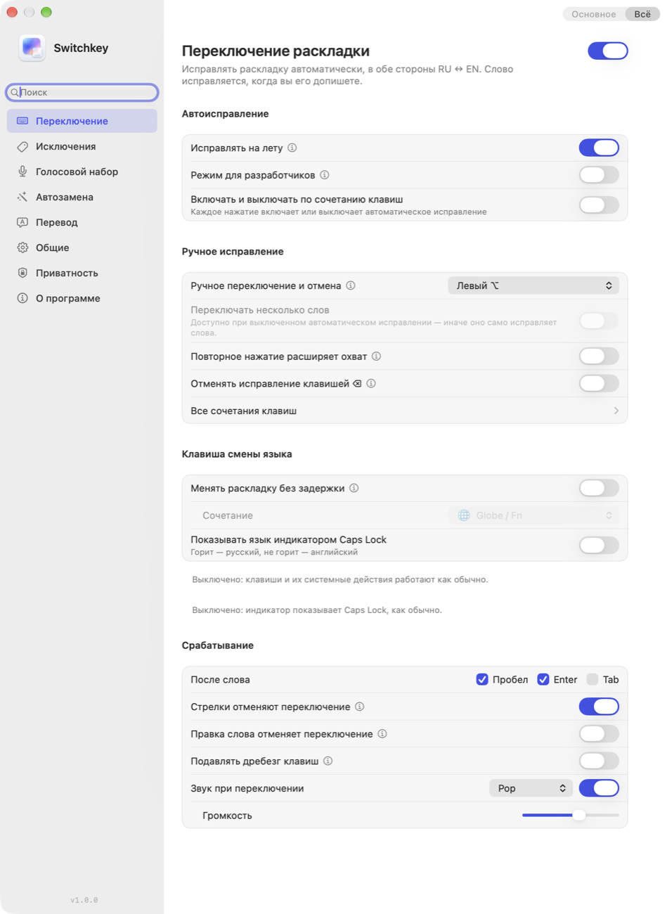
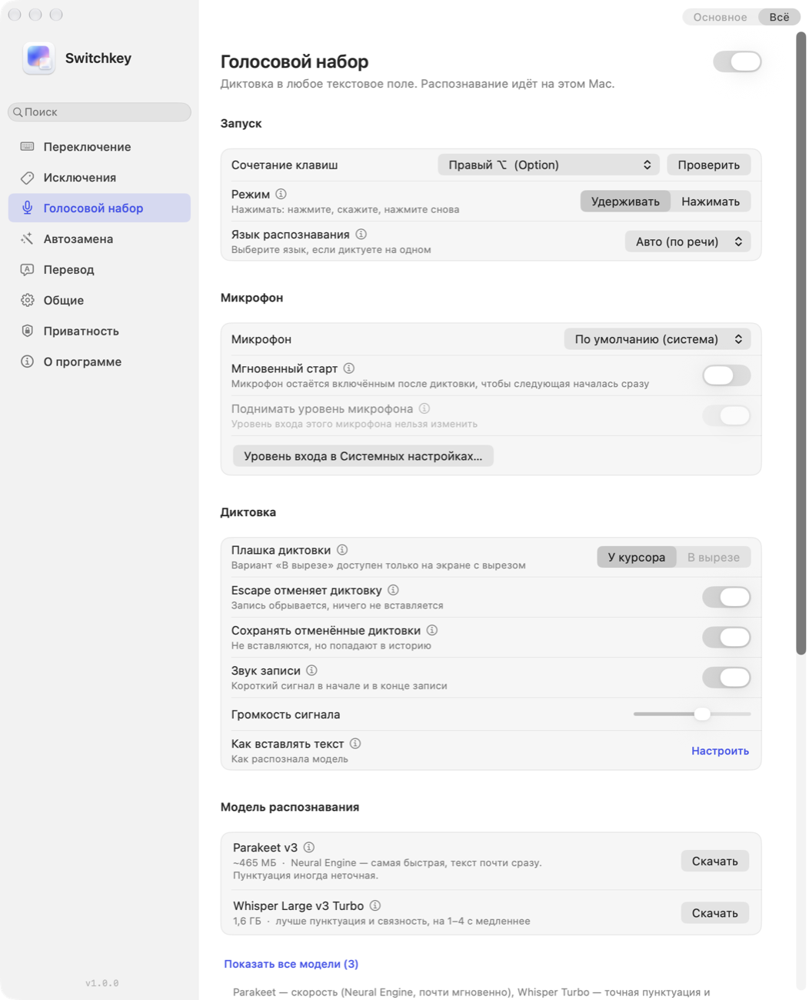
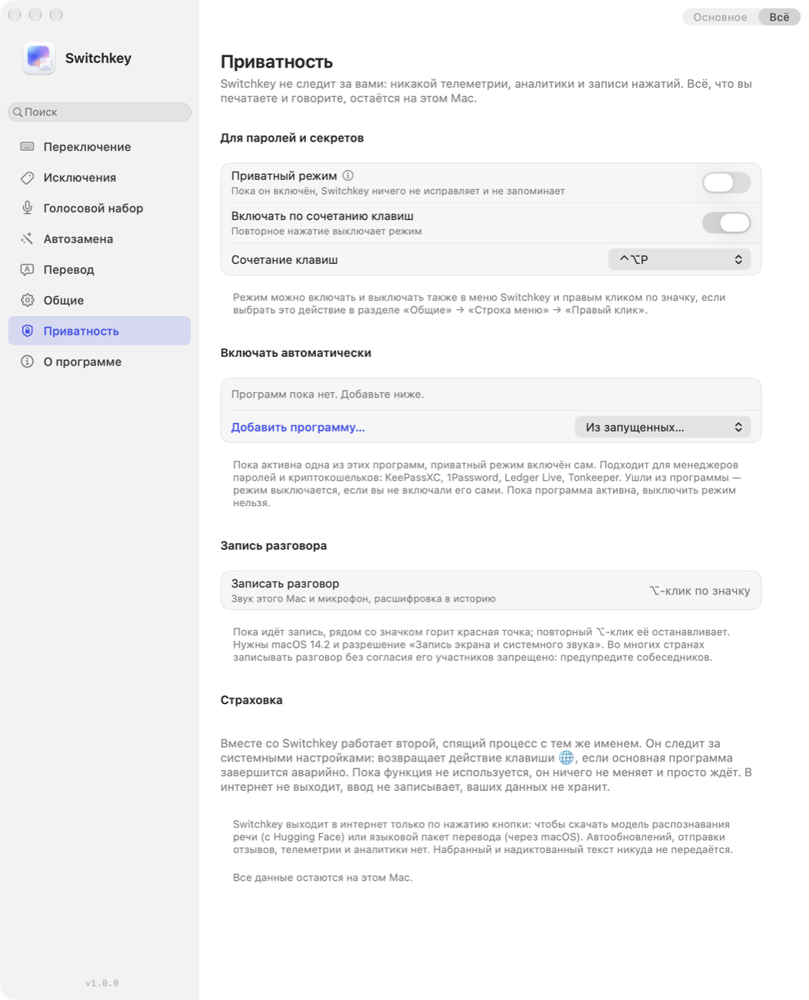

# Switchkey

Переключатель раскладки и голосовой набор для macOS. Исправляет слова, набранные не в той
раскладке, печатает под диктовку и переводит выделенный текст. Всё работает на вашем Mac: без
аккаунтов, облака, телеметрии и автообновлений.

**[Скачать Switchkey 1.0.0](https://github.com/DoJustCode/switchkey/releases/latest)** — Mac на
Apple Silicon (M1 и новее), macOS 14 или новее. Программа подписана сертификатом разработчика и
проверена Apple.

## Возможности

- **Исправление раскладки.** Набрали `ghbdtn` вместо «привет» — слово исправится само, по пробелу
  или прямо во время набора. Исправить вручную или отменить исправление — ⌥⇧ (можно назначить
  другое сочетание, в том числе левый или правый ⌥).
- **Мгновенная смена языка** клавишей 🌐, Caps Lock или своим сочетанием, без системной задержки.
- **Голосовой набор.** Нажмите правый ⌥ и говорите: речь распознаётся на этом Mac моделью
  Parakeet или Whisper, а текст вставляется туда, где стоит курсор.
- **Перевод выделенного** русский ↔ английский по ⌃⌥T встроенным переводчиком macOS (macOS 15 и
  новее).
- **Автозамена и сниппеты:** сокращение разворачивается в фразу, длинные тексты вставляются из
  списка по сочетанию.
- **Правка текста:** опечатки, две заглавные подряд, смена регистра, вставка без форматирования.
- **Исключения** для программ и слов, обучение на отменах.
- **История диктовки и буфера** — зашифрована и хранится только на этом Mac.
- **Приватный режим** (⌃⌥P) для паролей и секретов: пока он включён, Switchkey ничего не
  исправляет и не запоминает. В менеджерах паролей и криптокошельках может включаться сам.
- **Запись разговора** ⌥-кликом по значку: звук Mac и микрофон расшифровываются на этом Mac в
  историю. Во многих странах записывать разговор без согласия участников запрещено —
  предупреждайте собеседников.
- **Перенос настроек** на другой Mac одним файлом.

## Установка

1. Скачайте `Switchkey-1.0.0.dmg` со [страницы выпусков](https://github.com/DoJustCode/switchkey/releases/latest).
2. Откройте образ и перетащите Switchkey на папку «Программы».
3. Запустите Switchkey из «Программ» и выдайте разрешения в окне знакомства.

Дальше — [первые пять минут](docs/quickstart.md).

## Приватность

Switchkey не отправляет в интернет то, что вы набираете, копируете или диктуете. В сеть он
выходит только по вашей кнопке — чтобы скачать модель распознавания речи с Hugging Face; скачанная
модель проверяется по хешам. История зашифрована и хранится только на этом Mac. В журнал не
пишется содержимое: только длины слов и события. Подробно — в разделе
[«Приватность и безопасность»](docs/privacy.md).

Switchkey просит «Универсальный доступ» и «Мониторинг ввода»: без них переключатель раскладки не
видит клавиатуру. Это те же права, что у Punto Switcher и других переключателей.

## Документация

| Раздел | О чём |
|---|---|
| [Первые пять минут](docs/quickstart.md) | Установка, разрешения, первая проверка, диктовка |
| [Руководство](docs/guide.md) | Все функции и настройки, меню, сочетания клавиш |
| [Приватность и безопасность](docs/privacy.md) | Что Switchkey видит, что и где хранит, когда выходит в интернет |
| [Установка, обновление, удаление](docs/install.md) | Требования, обновление, перенос настроек, полное удаление |
| [Если что-то не работает](docs/troubleshooting.md) | Частые проблемы и их решения |
| [Справочник настроек](docs/settings-reference.md) | Каждая настройка: ключ, значение по умолчанию, где меняется; резервная копия и сброс |
| [Что нового](CHANGELOG.md) | Изменения по версиям |

## Снимки

| Голосовой набор | Приватность |
|---|---|
|  |  |

Плашка диктовки у курсора:

## Лицензия

MIT, см. [LICENSE](LICENSE). Программа распространяется «как есть», без гарантий. Сторонние
библиотеки и модели распознавания речи перечислены в [THIRD_PARTY.md](THIRD_PARTY.md).
